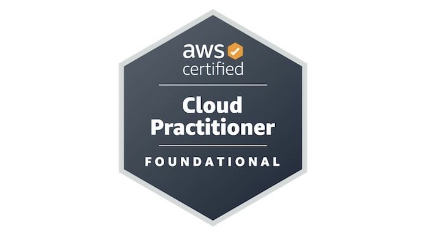



If you made it here, it means you want to start your cloud journey, specifically with AWS as your provider, and you are not quite sure where to begin. Well, relax, that is normal and I want to help you. 🤩

My goal here is not to sell you any course or magic solution, don't worry. 😂 😅

Starting a new journey and learning something new can be somewhat complicated, especially when we don't have the right guidance. This is where I want to help.

The first thing I have to say is: be patient! That's right, be patient, because everything takes time, and earning your first AWS certification will be no different. 🤯

The first AWS certification is the **Cloud Practitioner (CLF-C01)**. Cloud Practitioner is a foundational-level certification. This means that after preparing for this exam, you will have an overview of the fundamentals of cloud computing and of the main products and services offered by this provider. You will be ready to take your first steps, join a work meeting, understand the technical terms people are using and probably contribute to the discussion.

The second thing I would like to share with you is: stay focused and stop consuming content from many different sources that probably won't help you effectively.

In the market and in the community, there are certainly many well-intentioned people who share quality content. However, in the same proportion, there are many charlatans trying to sell you miracle recipes and courses that supposedly will solve your problem. I'm sorry, but I have to tell you that they won't. Don't fall for it, and don't throw your precious money away! Respect your money.

AWS is a very generous company and offers its customers several ways for people interested in getting certified to prepare. This includes live online training, workshops, bootcamps and even academies with complete learning paths, all for free.

That's right, free :D. All of this so you can reach your final goal, which in this context is earning your first certification. It's a win-win relationship, there are only advantages here! Look at it from this perspective:

With these initiatives, AWS gets more certified professionals who know its products and services. A point for AWS, right?

By earning your certification, you get one more way to prove to the market that you know at least the basics of what you are talking about, right? A point for you!

Companies, in turn, get one more way to find professionals with knowledge of specific topics for specific needs, and that makes it easier to filter candidates for a possible hire, right? A point for the company!

See? It's a win-win relationship.

But Enoque, I know a lot of people who have deep knowledge and no certification! I know they exist, and that's fine. But if you made it this far, I assume you know the advantages of getting certified. So I won't argue about whether or not to get a certification, okay?

Okay, but then how do I do it? lol

Here we go: for the entry-level certification, I strongly recommend using AWS's own official online learning platform, [Skill Builder]( https://explore.skillbuilder.aws/).

On Skill Builder you will find many trainings that were designed and built by AWS's own professionals. In other words, you will be drinking straight from the source, so don't waste time looking for alternative sources: focus on your goal and use quality content.

After signing up on the platform, look for [AWS Cloud Practitioner Essentials (Portuguese)](https://explore.skillbuilder.aws/learn/course/external/view/elearning/8287/aws-cloud-practitioner-essentials-portuguese) and you will find the official training, fully in Portuguese (the course is also available in English and other languages). Now go for it.

One last thing I wanted to tell you is: have a study routine. That's right!

Many people reach out asking for suggestions on how to take the first step toward their first certification. My answer is exactly what I wrote here for you.

The big point is that none of this will help if you are not disciplined and don't really study. So build a study plan and study **X** hours a day for as many days as you can. Take notes and rewind the video as many times as needed until you understand the content of the video course. Whenever you feel some information is missing, also check the official documentation for each service. AWS provides excellent documentation, available in several languages.

Build a study plan that is realistic and that you can actually follow. Be honest with yourself, because if you fail, you will be failing yourself, so be honest and build the plan according to your availability. Obviously, the faster you complete the course, the faster you will reach your goal, but remember that this is not a competition, and the most important thing here is the learning process and the knowledge you gain from it. So stay calm and give it your all, it will work out.

Following these steps, I have no doubt you will succeed and earn your first AWS certification.

But Enoque, is this course enough? Yes!

The course is very complete and has knowledge-check quizzes at the end of each module. Avoid distractions and focus on absorbing as much as possible of what the instructors are sharing with you. It worked for me, and I have a few success stories from colleagues who also made it with this content.

## #protip

🚀 🙅🏻‍♂️

When you get there, I will be immensely happy to receive a message from you sharing the achievement, celebrating and maybe thanking me for having contributed in some way to it. I will be immensely happy to read it. 🤩

Follow me on social media. I am always sharing useful information about the tech world, cloud, the JVM and more.
