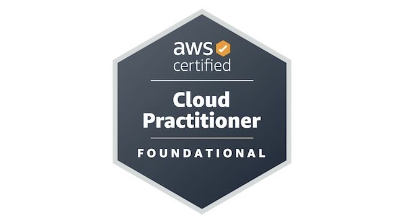

Se você chegou até aqui, significa que você deseja iniciar sua jornada em cloud, especificamente utilizando a AWS como provedor e não sabe muito bem por onde começar. Pois bem, fica tranquil@, isso é normal e eu quero te ajudar. 🤩

Meu objetivo aqui não é vender nenhum curso nem solução mágica, fiquem tranquilos. 😂 😅

Iniciar uma nova jornada e aprender algo novo, pode ser de certa forma um tanto complicado, principalmente nos casos onde não tenhamos o direcionamento adequado. É aqui que eu quero te ajudar.

A primeira coisa que eu tenho a dizer é: Tenha calma! Isso mesmo, tenha calma porque tudo requer tempo e conquistar sua primeira certificação AWS não será diferente. 🤯

A primeira certificação da AWS é a **Cloud Practitioner (CLF-C01)**. A Cloud Practitioner é uma certificação de nível foundational. Isso quer dizer que após se preparar para esse exame, você terá uma visão sobre os fundamentos de computação em nuvem (cloud computing) e sobre os principais produtos e serviços oferecidos por esse provedor. Você estará apt@ a dar os seus primeiros passos, entrar em uma reunião de trabalho, entender os termos técnicos que as pessoas estão falando e possivelmente vai conseguir contribuir com o coletivo.

A segunda coisa que eu gostaria de compartilhar com você é: Tenha foco e pare de consumir conteúdo de diferentes fontes e que possivelmente não vai te ajudar de forma efetiva. 

No mercado e na comunidade, certamente tem muita gente bem-intencionada e que compartilha conteúdo de qualidade. Porém na mesma proporção, existe muitos charlatões querendo te vender receitas milagrosas e cursos que supostamente vai resolver o seu problema. Sinto muito, mas preciso te dizer que não vai. Não caia nessa e não jogue seu precioso dinheiro fora R$! Respeite o seu dinheiro.

A AWS é uma empresa muito generosa e oferece a seus clientes, diversas formas para que as pessoas interessadas em obter suas certificações possam se preparar. Isso inclui treinamentos on-line ao vivo, workshops, bootcamps e até academias com formações completas e de forma gratuita.

É isso mesmo, no 0800 (free) :D. Tudo isso para que você consiga atingir o seu objetivo final, que nesse contexto é conquistar sua primeira certificação. Isso implica em uma relação de ganha a ganha, só há vantagens aqui! Olhe pela seguinte perspectiva:

Com essas ações a AWS terá mais profissionais certificados e que conhecem seus produtos e serviços. Ponto para a AWS certo? 

Você conquistando sua certificação, terá mais uma forma de comprovar para o mercado que você conhece e sabe minimamente do que está falando certo? Ponto para você!

Já as empresas por sua vez, ganha mais uma forma de procurar profissionais com conhecimentos sobre temas específicos para demandas específicas e dessa forma, consegue filtrar com mais facilidade para uma possível contratação certo? Ponto para a empresa!

Viu só? É uma relação de ganha a ganha.

Mas Enoque, eu conheço muitas pessoas que tem profundo conhecimento e não tem certificação! Eu sei que existe e está tudo bem em relação a isso. Porém se você chegou até aqui, infiro que você saiba quais são as vantagens de tirar uma certificação. Portanto, eu não irei discutir com sobre a questão de tirar ou não tirar uma certificação, tudo bem?

Tá, mas e aí, como faz então? rs 

Vamos lá, para a certificação de entrada eu recomendo fortemente que você utilize a plataforma de cursos on-line oficial da própria AWS, o [Skill Builder]( https://explore.skillbuilder.aws/). 

No Skill Builder você encontrará diversos treinamentos que foram projetados e construídos pelos profissionais da própria AWS. Em outras palavras, você beberá direto da fonte, portanto  não perca tempo buscando por fontes alternativas, foque no seu objetivo e utilize um conteúdo de qualidade.

Após se cadastrar na plataforma, procure por [AWS Cloud Practitioner Essentials (Portuguese)](https://explore.skillbuilder.aws/learn/course/external/view/elearning/8287/aws-cloud-practitioner-essentials-portuguese), você encontrará o treinamento oficial, totalmente em português. Agora é só partir para o abraço.

Uma última coisa que eu queria te dizer é: Tenha uma rotina de estudos. Isso mesmo!

Muitas pessoas me chamam para conversar pedindo sugestões sobre como dar o primeiro passo rumo à primeira certificação. Minha resposta é exatamente o que eu escrevi aqui para vocês.

O grande ponto é, nada disso vai adiantar se você não tiver disciplina e estudar de verdade. Então monte um plano de estudo e estude **X** horas por dia durante quantos dias você puder. Faça anotações e volte o vídeo quantas vezes for necessário para que você consiga entender o conteúdo do curso em Vídeo. Sempre que sentir falta de alguma informação, consulte também a documentação oficial de cada serviço. A AWS disponibiliza uma excelente documentação que está disponível em diversos idiomas inclusive em português. 

Monte um plano de estudo que seja realista e que você possa cumprir. Seja honest@ com você mesmo, porque se você falhar, estará falhado com você mesmo, então seja honesto e monte o plano de acordo com sua disponibilidade. Obviamente quanto mais rápido você fizer o curso, mas rápido chegará no seu objetivo, mas lembre-se de que não se trata de uma competição e o mais importante aqui é o processo de aprendizagem e o conhecimento adquirido a partir do mesmo. Então tenha calma e vai de coração que vai dar bom.

Seguindo esses passos eu não tenho dúvida que você irá ter êxito e conquistará sua primeira certificação AWS.

Mais Enoque, esse curso é o suficiente? Sim!

O curso é bem completo e possuí questionários para teste de conhecimento no final de cada módulo. Evite distrações e foque em absorver o máximo do que os instrutores estão compartilhando com você. Funcionou para min e tenho alguns cases de sucesso com colegas que também conseguiram chegar lá através desse conteúdo.

## #ficaadica

🚀 🙅🏻‍♂️

Quando você tiver chegado lá eu ficarei imensamente feliz em receber uma mensagem sua compartilhando a conquista, comemorando e talvez agradecendo por ter contribuído de alguma forma para essa sua conquista. Eu ficarei imensamente feliz em ler. 🤩

Me siga nas redes sociais. Eu estou sempre compartilhando informações úteis sobre o mundo tech, cloud, jvm e afins.
